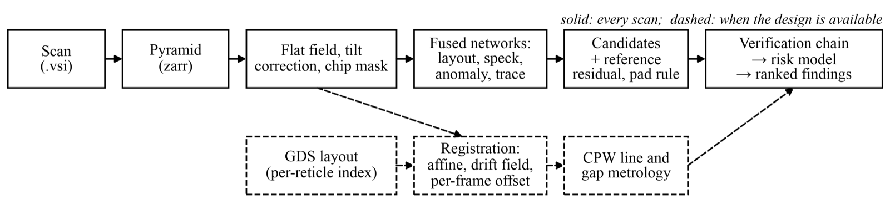
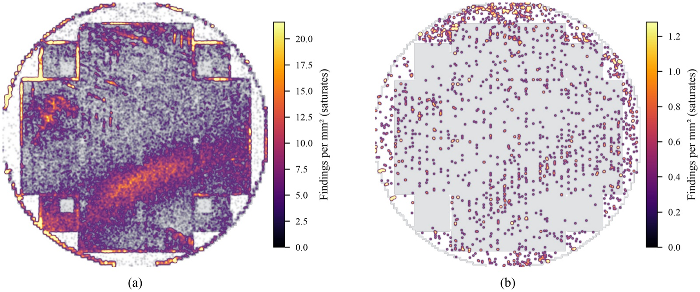
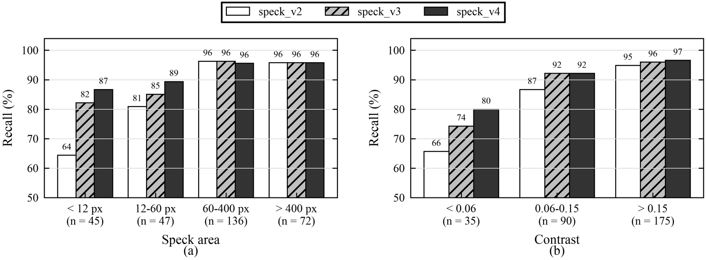
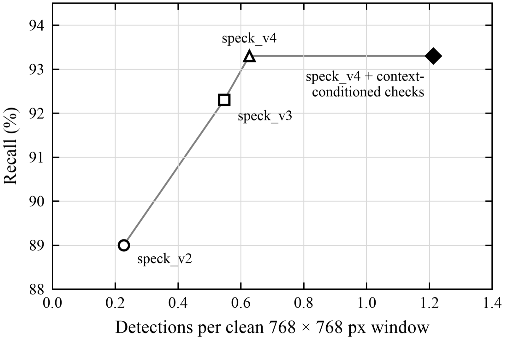
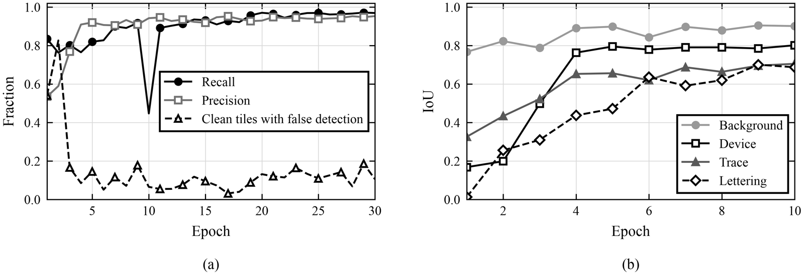
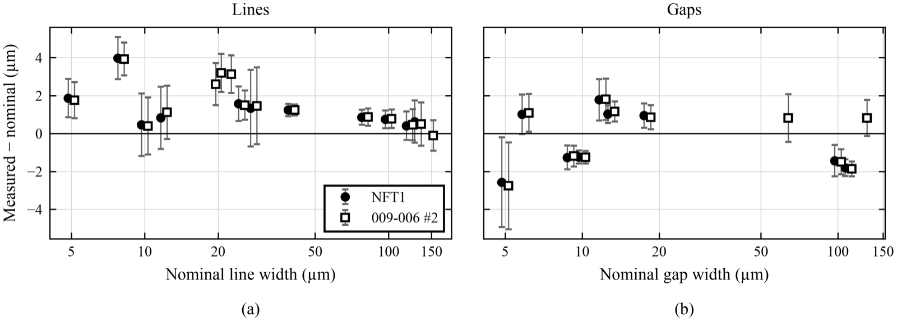
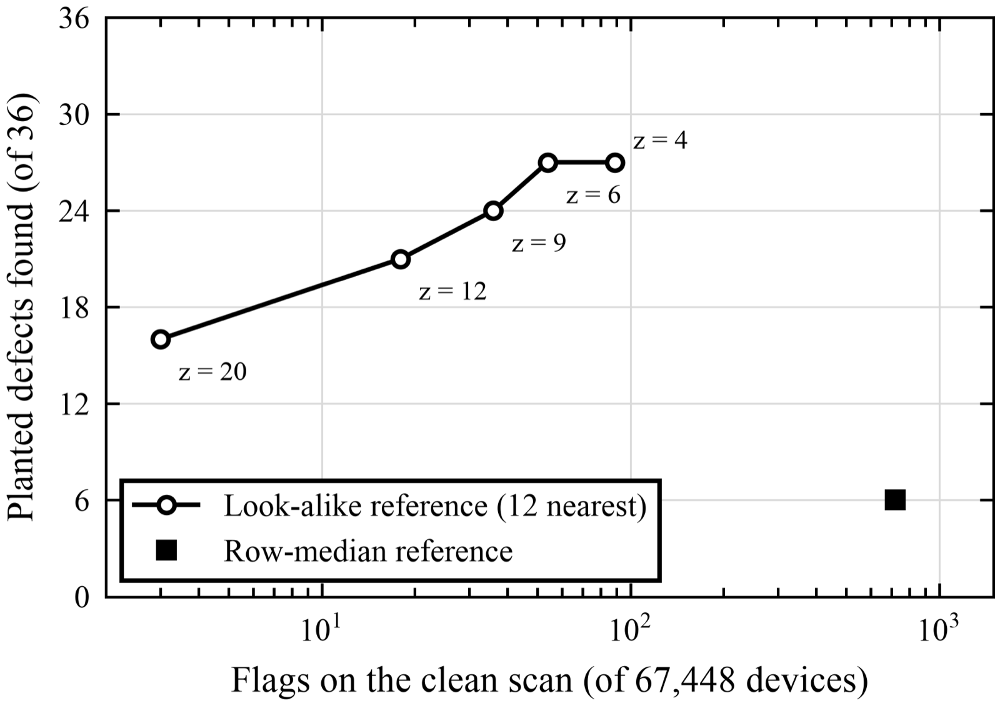

<p align="center">
  Automated optical inspection for wafers.<br>
  Microscope scan in -> annotated defects out
</p>

---

## What it does

A wafer-scale brightfield scan (such as the Olympus DSX1000, ~0.8 µm/px, billions of pixels) is far too slow to inspect
by eye. Chip Scanner reads it, straightens and fixes the stitching in the scan, then finds and ranks defects in three groups:

| Group | What it finds | How |
|---|---|---|
| **Specks** | dust, particles, fibres, residue, probe scrub marks | dedicated speck UNet + reference residual against identical chips + pad rule |
| **Trace errors** | opens, shorts, bridges, nicks on wiring | dedicated trace UNet (off by default while being validated) |
| **Component errors** | devices that differ from their look-alikes | each device compared with its 12 most similar instances (off by default: still too noisy on real chips) |

Each finding gets a **risk score from 0 to 100**. It goes up with the defect's size and with how close it sits to a
junction or a trace. Dust on bare ground plane ranks low; a particle touching a JJ ranks critical.

## Pipeline

<p align="center"></p>

1. **Straighten.** Measures the stage tilt and the camera-frame grid of the mosaic, then removes per-frame shading,
   so stitching seams do not turn into "defects".
2. **Layout.** A 4-class network (background, trace, component, text) maps the chip when no GDS is given. Lettering
   and test structures are recognised, so labels are never reported as dirt.
3. **Detect.** Specks are found three independent ways and merged:
   - a speck UNet, trained self-supervised by painting realistic dirt onto real scans;
   - a **reference residual**: every 384 px tile is aligned with its identical twins elsewhere on the scan, and
     anything only this copy has is dirt;
   - a rule for marks on bond pads.
4. **Verify.** Every candidate is re-checked against the same spot on its twins (1 px tolerance, median over
   twins). Designed structure is explained away. A dedicated test catches stitching ghosts, where two misregistered
   camera frames are blended.
5. **Rank and review.** Findings are risk-scored and served in a web viewer with deep zoom, group and risk filters,
   live sensitivity, and a review queue.

No design file is required. With a GDS, the layout comes from the design instead of the network.

## Results

Tested on superconducting quantum circuit wafers and chips from MIT RLE (Olympus DSX1000 brightfield, 1.0–1.6 µm/px).
Nothing in detection, verification or metrology is specific to that technology; only the risk table is.

**Where the dirt is.** Findings per mm² on a full 100 mm wafer (119,122 findings), drawn with the scan hidden. Left:
every finding, showing the wafer edge, reticle borders and a diagonal smear. Right: only medium risk and above; the
smear was low-risk dust.

<p align="center"></p>

**How much it finds.** 300 specks planted into a chip no model was trained on, run through the whole pipeline. Recall
on specks under 12 px rose from 64% to 87% across three model versions; overall it is 93.3%.

<p align="center"></p>

**What it costs.** Each gain in recall came with more detections on clean windows (most of them real dust in the scan).

<p align="center"></p>

**Training.** Validation curves for the speck network (left) and the layout network (right), trained with no hand
labels: defects are painted into clean tiles of the scans themselves.

<p align="center"></p>

**Line and gap widths.** With the GDS, widths are measured at more than 16,000 sites per wafer. Two wafers of the same
design agree to 0.1 µm; nominal 10 µm gaps measure 8.76 and 8.75 µm.

<p align="center"></p>

**Device comparison (off by default).** On 36 defects painted onto real devices, comparing each device with its
look-alikes finds 27 at 54 false flags in 67,448 devices; comparing with its row found 6 at 719.

<p align="center"></p>

Regenerate the figures with `uv run python scripts/paper/make_figures.py` (writes `paper/figures/`, which is not
tracked; the README copies are in `docs/images/`).

## Installation Guide

```bash
brew install uv vips
uv sync
uv run chipscan add /path/to/scan.png --name AFT5_C1 --pixel-size 0.814   # full scan, any size
uv run chipscan serve --runs runs                                         # http://localhost:8000
```

## Measuring it

`scripts/eval_specks.py` plants realistic specks into a held-out scan that no model was trained on. It runs the
complete pipeline, filters and twin checks included, and reports recall by speck size and contrast. It also reports
the alarm rate on the same windows without planted specks.


Design-referenced inspection against a GDS (registration, CD metrology, KLayout export) is documented in
[docs/DESIGN_REFERENCED.md](docs/DESIGN_REFERENCED.md).

<p align="center"><sub>Research Laboratory of Electronics · Massachusetts Institute of Technology</sub></p>
